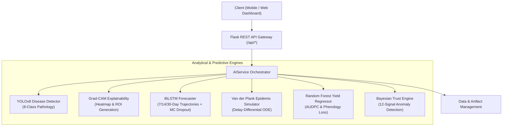

# CropSure: Agricultural AI Intelligence Platform

CropSure is an enterprise-grade agricultural intelligence backend combining deep learning, epidemic simulation, explainable AI, time-series forecasting, agronomic yield loss regression, and Bayesian trust verification.

---

## Architecture Overview



---

## Core Model Components

1. **YOLOv8 Disease Detector (`TomatoDiseaseDetector`)**
   - Detects 8 primary tomato conditions:
     - `Bacterial_spot`
     - `Early_blight`
     - `Late_blight`
     - `Leaf_Mold`
     - `Septoria_leaf_spot`
     - `Spider_mites`
     - `Target_Spot`
     - `Healthy`
   - Computes lesion surface ratio and severity index (`Low`, `Moderate`, `Severe`, `Critical`).
   - Supports ONNX export and CPU/GPU execution.

2. **Van der Plank Epidemic Simulator (`VanDerPlankSimulator`)**
   - Implements J.E. Van der Plank's delay-differential epidemiological formulation:
     $$\frac{dy}{dt} = r \cdot y(t - p) \cdot (1 - y(t))$$
   - Accounts for cardinal temperature responses ($T_{min}, T_{opt}, T_{max}$), humidity, and leaf wetness.
   - Calculates AUDPC (Area Under the Disease Progress Curve), infection inflection days, and comparative intervention scenarios.

3. **BiLSTM Disease Forecaster (`DiseaseForecaster`)**
   - Bidirectional PyTorch LSTM with dropout uncertainty estimation.
   - Generates 7-day, 14-day, and 30-day forecast horizons.
   - Monte Carlo Dropout produces 95% Bayesian epistemic confidence bounds.

4. **Grad-CAM Explainability Engine (`GradCAMEngine`)**
   - Generates visual activation heatmaps showing exact leaf symptom regions that drove detection.
   - Computes high-activation Regions of Interest (ROIs) for agronomist verification.
   - Produces blended visual overlays in standard base64 format.

5. **Random Forest Yield-Loss Regressor (`YieldLossRegressor`)**
   - Ensemble regression predicting crop yield loss percentage ($0.0 - 100.0\%$).
   - Inputs: AUDPC, phenological growth stage, remediation latency days, vapor pressure deficit (VPD), disease severity, average temperature, and humidity.
   - Provides feature importance rankings and agronomic remediation sensitivity.

6. **Bayesian Trust Engine (`BayesianTrustEngine`)**
   - Conjugate Beta-prior updating model integrating 12 verification signals:
     1. Image quality (blur, sharpness, resolution)
     2. GPS consistency (agricultural bounds)
     3. Temporal consistency (diurnal & seasonal plausibility)
     4. Disease severity plausibility (incubation kinetics)
     5. Weather correlation (meteorological pathogen support)
     6. Historical pattern (farm baseline)
     7. Device fingerprint (camera EXIF consistency)
     8. Submission frequency (anti-spam / anti-bot)
     9. Metadata completeness
     10. Expert agreement history
     11. Cross-validation across peer sensors
     12. Community consensus
   - Built-in automated anomaly detection for:
     - Geospatial teleportation (>100 km in <1 hr)
     - Scan rate flooding (>20 submissions/hr)
     - Biological impossibility (>30% severity drop in 24 hr without treatment)

7. **Solana Devnet Blockchain Ledger (`SolanaService`)**
   - Anchors leaf specimen diagnostic proofs directly to the Solana Devnet blockchain.
   - Computes deterministic SHA-256 cryptographic fingerprints of leaf specimens.
   - Emits immutable SPL Memo transactions (`MemoSq4gqABAXKb96qnH8TysNcWxMyWCqXgDLGmfcHr`) embedding:
     `{"p":"CropSure-v1","type":"CROP_PASSPORT","hash":"<sha256>","disease":"...","conf":0.94,"sev":35.0,"ts":"..."}`
   - Provides verifiable on-chain Explorer links (`https://explorer.solana.com/tx/<sig>?cluster=devnet`) and real-time validator verification endpoints.

---

## Directory Structure

```
agriculture/
├── requirements.txt
├── .gitignore
├── README.md
├── backend/
│   ├── run.py                     # Entry point for backend server
│   ├── app/
│   │   ├── __init__.py            # Flask app factory, CORS, blueprints
│   │   ├── config.py              # Configuration & disease class definitions
│   │   ├── models/                # Machine learning and mathematical models
│   │   │   ├── __init__.py
│   │   │   ├── yolov8_detector.py
│   │   │   ├── vanderplank_simulator.py
│   │   │   ├── lstm_forecaster.py
│   │   │   ├── gradcam_engine.py
│   │   │   ├── yield_regressor.py
│   │   │   └── bayesian_trust.py
│   │   ├── services/              # Business logic & orchestration
│   │   │   ├── __init__.py
│   │   │   ├── ai_service.py      # Unified model coordinator
│   │   │   └── data_service.py    # Data caching & artifact manager
│   │   ├── routes/                # REST API endpoints
│   │   │   ├── __init__.py
│   │   │   └── api.py
│   │   └── utils/                 # Utility functions
│   │       ├── __init__.py
│   │       ├── image_utils.py     # Image validation & tensor transforms
│   │       └── metrics.py         # Regression & classification metrics
│   └── tests/                     # Automated test suites
│       ├── __init__.py
│       ├── conftest.py            # Pytest fixtures
│       ├── test_models.py         # Unit tests for all 6 models
│       └── test_api.py            # API endpoint integration tests
```

---

## Installation & Setup

### 1. Prerequisites
- Python 3.10+ (Recommended: Python 3.10, 3.11, or 3.12)
- Virtual environment tool (`venv`)

### 2. Setup Virtual Environment
```bash
python -m venv venv
# Windows:
venv\Scripts\activate
# Linux/macOS:
source venv/bin/activate
```

### 3. Install Dependencies
```bash
pip install -r requirements.txt
```

### 4. Running the Development Server
```bash
python backend/run.py
```
The server will start at `http://127.0.0.1:5000`.

---

## API Documentation

### Health & Status
- **`GET /api/health`**
  - Returns backend health, operational status, and platform timestamp.
- **`GET /api/models/status`**
  - Returns status of all 6 models, runtime devices (CPU/GPU), and memory footprints.

### Comprehensive Leaf Analysis
- **`POST /api/analyze`**
  - Multipart form upload (`image`) or JSON payload with base64 image.
  - Optional fields: `metadata`, `latitude`, `longitude`, `timestamp`, `history`.
  - Runs detection, Grad-CAM, forecasting, yield loss regression, and trust scoring in a single unified call.

### Specialized Analytical Endpoints
- **`POST /api/detect`**: Image-only pathology detection with bounding boxes and severity.
- **`POST /api/explain`**: Grad-CAM visual explanation returning heatmap base64 and ROIs.
- **`POST /api/forecast`**: Predicts disease progression over 7, 14, and 30 day horizons.
- **`POST /api/yield-loss`**: Predicts economic crop loss from AUDPC, phenology stage, and VPD.
- **`POST /api/trust`**: Bayesian trust verification across 12 signals and anomaly checks.
- **`GET /api/epidemic/simulate`**: Simulates Van der Plank disease trajectory with custom parameters.
- **`GET /api/epidemic/scenarios`**: Compares Favorable, Unfavorable, Treated, and Untreated scenarios.

---

## Testing

Run tests with `pytest`:
```bash
pytest backend/tests/ -v
```
